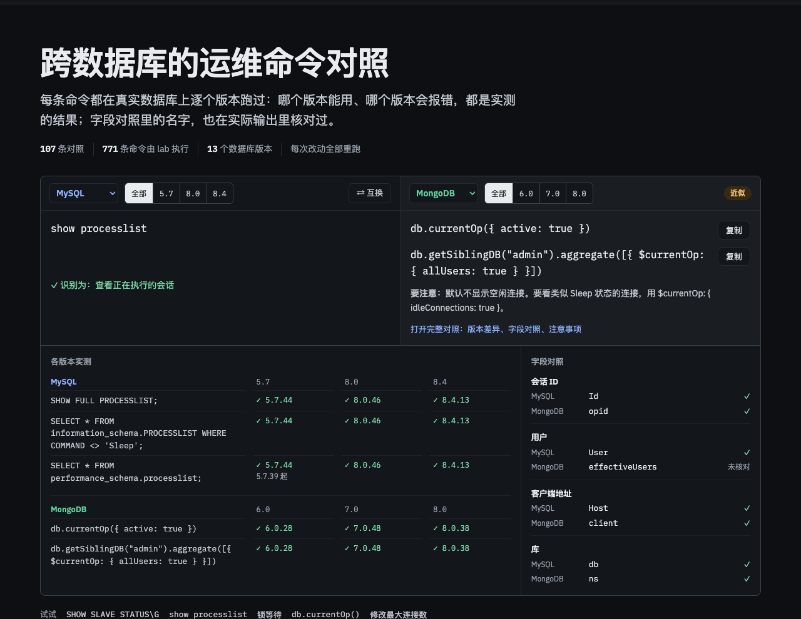

# DBA Command Finder

[](https://github.com/yinx0004/dba-command-finder/actions/workflows/ci.yml)
[](https://www.solidstack.io/dba-command-finder/zh/#method)
[](https://www.solidstack.io/dba-command-finder/)
[](LICENSE)
[](https://github.com/yinx0004/dba-command-finder/commits/main)

[](https://www.solidstack.io/dba-command-finder/zh/#browse)
[](https://www.solidstack.io/dba-command-finder/zh/#browse)
[](https://www.solidstack.io/dba-command-finder/zh/#browse)
[](https://www.solidstack.io/dba-command-finder/zh/#browse)
[](https://www.solidstack.io/dba-command-finder/zh/#browse)

[](https://astro.build/)
[](https://react.dev/)
[](https://www.typescriptlang.org/)
[](https://nodejs.org/)
[](https://www.solidstack.io/dba-command-finder/zh/)

同一件运维任务，在 MySQL、MongoDB、Redis、PostgreSQL、TiDB 里分别怎么写？贴一条命令，直接看到其他库的写法。

**网站：<https://www.solidstack.io/dba-command-finder/>**



## 能做什么

- **翻译命令**：贴一条任意库的命令，比如 `SHOW SLAVE STATUS\G`，得到另一个库的对应写法。也可以直接写要做的事，比如「锁等待」。
- **按任务查**：常见的运维任务按会话、复制、备份恢复、索引等类别整理，每件事列出五个库各自的命令。
- **按版本看**：选自己用的版本，就能看到哪些命令能用、哪些已经废弃或移除，以及该换成什么写法。
- **字段对照**：输出里的字段一一对上，比如 MySQL 的 `Id` 对应 MongoDB 的 `opid`、PostgreSQL 的 `pid`。
- **做不到时说清楚**：某个库没有对应命令时，写明原因和可以改看什么，不硬凑一条近似的。

## 为什么可以直接用

- 页面上的每条命令，都原样在 Docker 里的真实数据库上执行过，每个版本各跑一次。
- 标了「8.0 起」的命令，在 5.7 上必须报错；标了「8.4 移除」的，在 8.4 上必须报错。版本写错，CI 就不通过。
- 字段对照里的字段名，必须出现在命令的实际输出里。
- 测试、lab、构建任何一步失败都不会部署，线上不会出现没通过验证的命令。

怎么验证的、每次跑了哪些版本，见网站首页的「命令是怎么验证的」，或者 [CONTRIBUTING.md](CONTRIBUTING.md#验证-lab)。

## 本地运行

需要 Node.js 22.12 或更高版本。

```bash
npm install
npm run dev      # http://localhost:4321/dba-command-finder/
npm test         # 数据校验和搜索回归测试
npm run build    # 生成静态站点到 dist/
```

在真实数据库上验证命令需要 Docker，见 [CONTRIBUTING.md](CONTRIBUTING.md#验证-lab)。

## 参与贡献

内容都在 `data/` 里的 YAML 文件中，一件运维任务一个文件，不用改代码。新增、修改条目的方法，数据格式，以及 lab 怎么验证，都写在 [CONTRIBUTING.md](CONTRIBUTING.md)。

发现命令写错、版本标错，或者想补一条对照，也可以直接[提 issue](https://github.com/yinx0004/dba-command-finder/issues/new)。

## 许可

[Apache-2.0](LICENSE)

---

*A lookup site for DBAs working across MySQL, MongoDB, Redis, PostgreSQL and TiDB: paste a command from one database and get the equivalent in another, with every command run against real servers, version by version. Chinese first; English pages will follow.*
